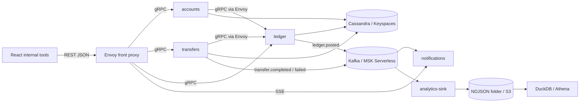

# Event Ledger Bank

[](https://github.com/mini4141/event-ledger-bank/actions/workflows/ci.yml)

A small but real banking backend: Go services talk gRPC through **Envoy**, persist a double-entry ledger in **Cassandra**, publish every movement to **Kafka**, run on **Kubernetes**, and expose a **React** internal-tools app. The cloud version swaps in Amazon Keyspaces, MSK Serverless, EKS and S3 + Athena.



## Quickstart (local)

Needs Docker Desktop, Go, Node + pnpm, buf. `bash` scripts (Git Bash on Windows):

```bash
scripts/dev-up.sh        # compose stack + demo data; app at http://localhost:18080
scripts/test-all.sh      # buf, unit, integration, grpcurl smoke, Playwright
scripts/dev-down.sh
```

Other local ports: Jaeger http://localhost:26686, Prometheus http://localhost:29090.
`scripts/kind-up.sh` runs the same images on a kind cluster (Kustomize, `deploy/k8s/overlays/kind`).

## AWS (Phase 2/3)

```bash
scripts/deploy.sh        # terraform apply, ECR push, kustomize overlay eks, seed, smoke, Athena query
scripts/destroy.sh       # remove NLB + namespaces, empty buckets, terraform destroy
scripts/verify-destroyed.sh
```

Uses the AWS profile `event-ledger-bank-deployer` in `ap-southeast-2`. Everything is tagged `Project=event-ledger-bank`.

## More

- Proof index: [proof/README.md](proof/README.md)
- Write-up: [docs/PORTFOLIO.md](docs/PORTFOLIO.md)
- Data model: [docs/data-model.md](docs/data-model.md) · Decisions: [docs/DECISIONS.md](docs/DECISIONS.md) · AI usage: [docs/AI_USAGE.md](docs/AI_USAGE.md)
