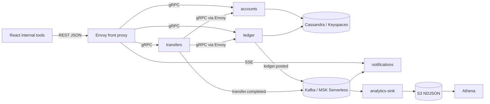

# SPECS.md: Event Ledger Bank

## 1. Summary

A mini banking platform built the way a modern bank's backend is, at small scale. Go microservices communicate over gRPC through Envoy. Every money movement becomes a double-entry ledger posting in Cassandra and an event on Kafka. Downstream consumers then:

- push notifications into a live feed, and
- land the events in S3 for SQL analytics in Athena.

It all runs on Kubernetes. A React internal-tools app lets you inspect customers, accounts and the event stream.

**Demo story:**
1. Create Alice and Bob and fund Alice.
2. Transfer £25 from Alice to Bob.
3. The ledger shows two balanced entries, the feed shows the event live, and Athena counts the transfers.
4. Replay the same idempotency key: no double spend.

## 2. Requirement coverage matrix

| Requirement / tech | Covered by | Proof |
|---|---|---|
| Strong backend on a tech product, distributed systems, resilient software | 5 Go services, idempotency, Envoy retries/outlier detection, consumer at-least-once with idempotent processing | Tests, Envoy stats |
| Go | All services | CI |
| Cassandra | Ledger, accounts, idempotency tables; Keyspaces in AWS | cqlsh output, Keyspaces describe |
| Kafka async queue | Events + consumers; MSK Serverless in AWS | Consumer logs |
| Kubernetes + Docker | kind and EKS, Kustomize | kubectl output |
| Envoy for RPC | Front proxy, gRPC routing, JSON transcoding | Envoy admin `/clusters` dump |
| AWS production infra; GCP for data → AWS equivalent | EKS, Keyspaces, MSK, S3 + Athena | resources.txt, Athena result |
| React for internal tools | `web/` | Screenshots |
| Product mindset / data-informed | Analytics sink + Athena queries (daily volume, top accounts) | Athena result log |

## 3. Architecture



## 4. Repository layout

```
proto/                 buf.yaml, bank/v1/{accounts,ledger,transfers,events}.proto
services/accounts/  services/ledger/  services/transfers/  services/notifications/  services/analytics-sink/
envoy/                 envoy.yaml (local), envoy-eks.yaml
web/                   React + Vite
deploy/k8s/base/       per-service Deployment/Service, envoy, web
deploy/k8s/overlays/   kind/, eks/
db/cql/                schema.cql (local)
infra/                 Terraform
analytics/             athena/*.sql, duckdb/*.sql
scripts/
```

## 5. Features (end-to-end)

### F1: Customers and accounts
- `CreateCustomer`, `OpenAccount(customer_id, currency)`, `GetAccount`, `ListAccounts`, plus `Deposit` (a test-funds ledger posting from a `bank_funding` system account).
- **Accept:** the web UI creates Alice with a GBP account, deposits 100.00, and the account shows a balance of 100.00.

### F2: Transfer (sync orchestration)
- `transfers.CreateTransfer{idempotency_key, from, to, amount_minor}` does the following:
  1. Inserts the idempotency row with `IF NOT EXISTS`. If the row already exists, it returns the original result.
  2. Calls `ledger.Post` with two entries.
  3. Publishes `transfer.completed`.
- `ledger.Post` checks the funds and conditionally updates both balances (LWT on version, retried on conflict), then writes the entries and publishes `ledger.posted`.
- **Accept:** a 25.00 transfer leaves balances of 75.00 and 25.00, and a replay with the same key returns the same transfer ID without changing the balances.

### F3: Notifications and live feed
- `notifications` consumes `transfer.completed` and keeps the last 100 events in memory. `GET /v1/feed/stream` serves them as SSE through Envoy.
- **Accept:** the web Feed page shows the transfer within 2 seconds.

### F4: Analytics
- `analytics-sink` consumes every topic and writes hourly-partitioned NDJSON (`dt=YYYY-MM-DD/hour=HH/`): to a local folder in Phase 1, to S3 in Phase 2. A Glue table plus `analytics/athena/daily_volume.sql` and `top_accounts.sql` query it (DuckDB equivalents locally).
- **Accept:** the query returns a non-zero count after the seed script runs 50 transfers.

### F5: Envoy resilience
- Route timeouts (1 s), retries (`retry_on: unavailable,reset`, 2 attempts) and outlier detection on the `ledger` cluster.
- Drill: `scripts/drill-ledger-restart.sh` deletes the ledger pod while transfers run. Transfers recover, and Envoy stats show the retries.
- **Accept:** the drill log shows retries > 0 and a final success rate ≥ 95%.

### F6: Internal tools web app
- Pages: Customers (list/create), Account detail (balance + entries table), Transfer (form), Live Feed, System (health of each service through Envoy `/healthz` routes and Envoy cluster status).
- **Accept:** a Playwright happy path covers create → deposit → transfer → feed.

## 6. Data model (CQL)

- `accounts (account_id uuid PRIMARY KEY, customer_id, currency, balance_minor bigint, version int, created_at)`
- `customers (customer_id uuid PRIMARY KEY, name, created_at)`
- `accounts_by_customer (customer_id, account_id, PRIMARY KEY (customer_id, account_id))`
- `ledger_entries_by_account (account_id, posted_at timeuuid, posting_id, direction, amount_minor, counterparty, PRIMARY KEY (account_id, posted_at)) WITH CLUSTERING ORDER BY (posted_at DESC)`
- `transfers_by_idempotency_key (idempotency_key text PRIMARY KEY, transfer_id, status, created_at)`

## 7. Interfaces

The gRPC services are in `proto/bank/v1`. Envoy transcodes:

- `POST /v1/customers`
- `POST /v1/accounts`
- `GET /v1/accounts/{id}`
- `GET /v1/accounts/{id}/entries`
- `POST /v1/deposits`
- `POST /v1/transfers`
- `GET /v1/feed/stream` (SSE passthrough)
- `GET /v1/system/health`

## 8. Test plan

| Layer | Test |
|---|---|
| Unit | Posting entries sum to zero; idempotent replay returns the original |
| Integration | `go test -tags=integration ./...` with compose: transfer + consumer receives the event |
| Contract | `buf lint` + `buf breaking` against `main` |
| e2e | Playwright web happy path; grpcurl smoke through Envoy |

## 9. Phase 1: Local

- Docker Compose for fast dev (cassandra, kafka, jaeger, prometheus, services, envoy, web).
- **Plus** a kind deployment of the same images (`scripts/kind-up.sh`), with Cassandra and Kafka as single-node StatefulSets using the official images, to prove Kubernetes.

Checklist:
- [ ] `tests/`: go unit + integration JUnit, Playwright report
- [ ] `screenshots/01-customers.png`, `02-account-entries.png`, `03-transfer.png`, `04-live-feed.png`, `05-system-health.png`, `06-jaeger-transfer-trace.png`
- [ ] `logs/cqlsh-ledger.txt`, `logs/kafka-consume.txt`, `logs/envoy-clusters.txt`, `logs/duckdb-daily-volume.txt`, `logs/drill-ledger-restart.log`, `logs/kind-get-all.txt`

## 10. Phase 2: AWS

| Local | AWS |
|---|---|
| Cassandra container | Amazon Keyspaces (SigV4 via Pod Identity, TLS with the Starfield cert bundled in the image) |
| Kafka container | MSK Serverless (IAM SASL, topics created by an init Job using franz-go admin) |
| kind | EKS, 2× t3.medium SPOT, public subnets |
| local folder sink | S3 bucket + Glue table + Athena workgroup |
| Envoy NodePort | Envoy Service type LoadBalancer (NLB) |

`scripts/deploy.sh`:
1. `terraform apply`.
2. Build and push to ECR.
3. `kustomize build overlays/eks | envsubst | kubectl apply`.
4. Wait for rollout.
5. Seed.
6. Smoke + Playwright against the NLB.
7. Athena query.

- [ ] `screenshots/01-eks-feed.png`, `02-eks-account.png`, `03-eks-system.png`
- [ ] `logs/keyspaces-describe.json`, `logs/msk-describe.json`, `logs/athena-daily-volume.txt`, `logs/kubectl-eks.txt`, `resources.txt`
- [ ] `tests/playwright-eks/`

## 11. Phase 3: Destroy

`destroy.sh`:
1. Delete the Envoy Service (wait for the NLB to go) and the namespaces.
2. Empty the S3 buckets.
3. `terraform destroy`.

`verify-destroyed.sh` checks:
- no EKS cluster, MSK cluster (`aws kafka list-clusters-v2`), Keyspaces keyspace or load balancers;
- the VPC is gone.

## 12. Out of scope

Real auth, card payments, FX, physical data-centre links, and a production-grade Cassandra/Kafka operator.
