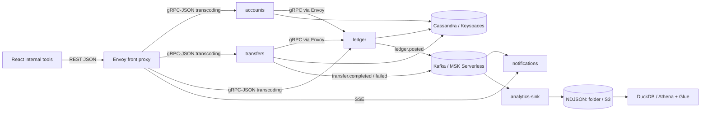
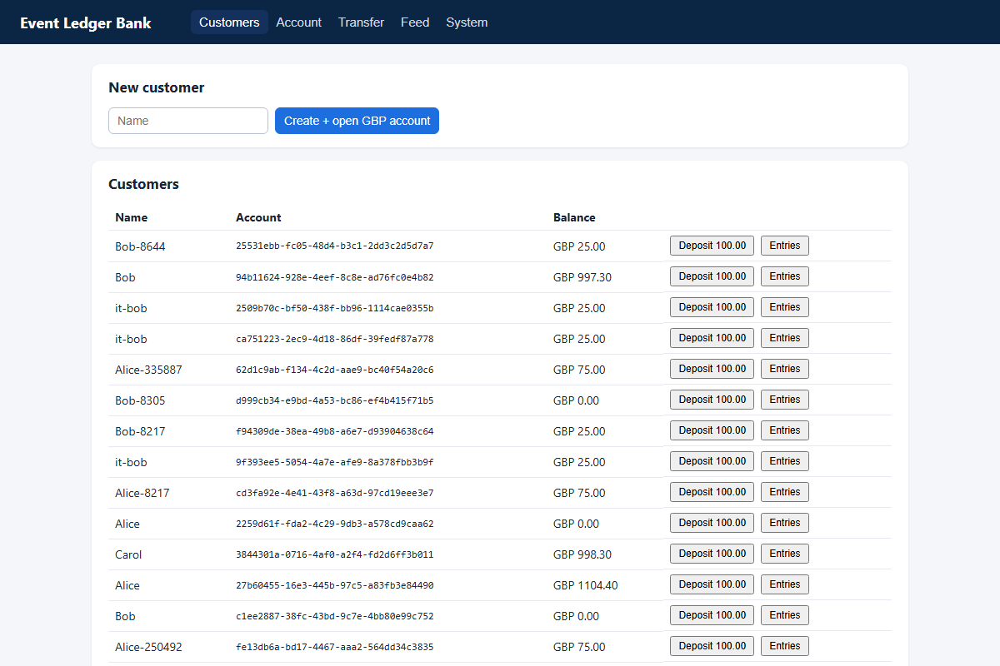
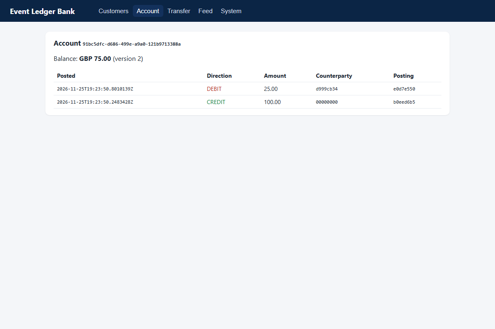
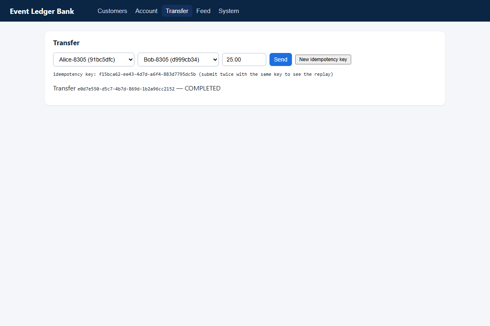
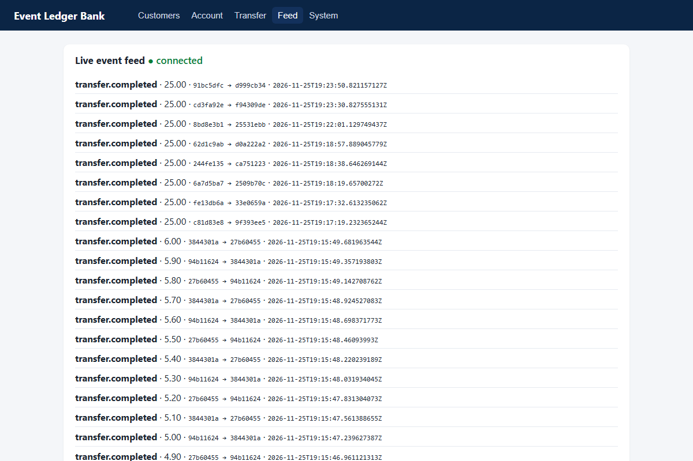
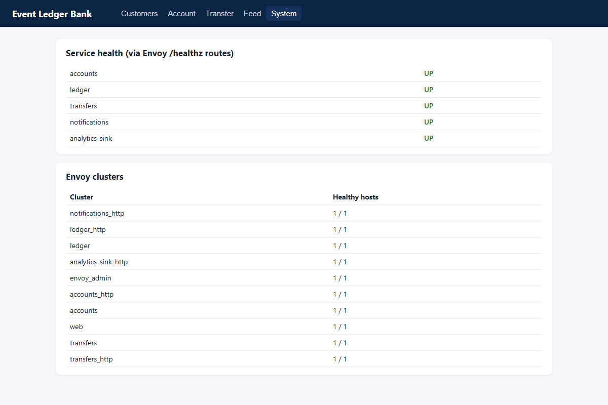
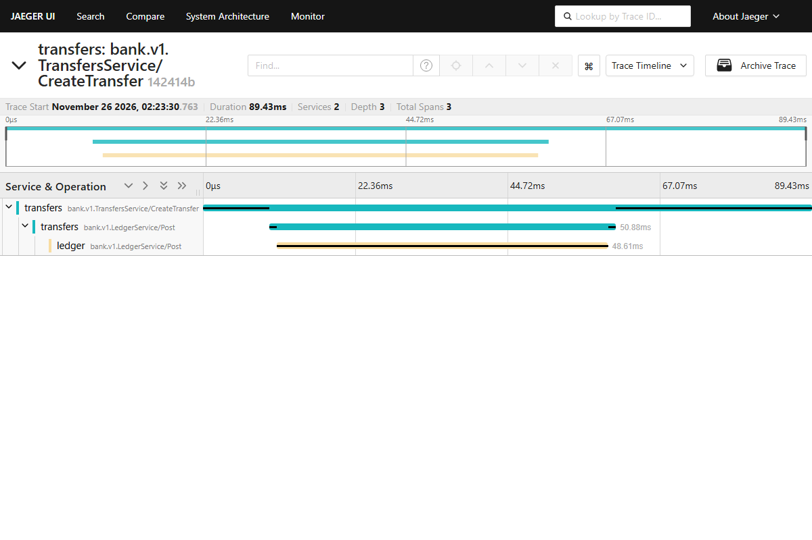
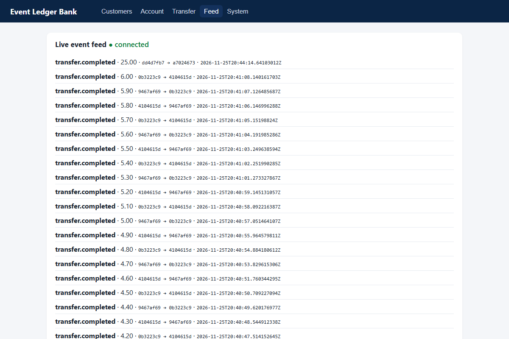
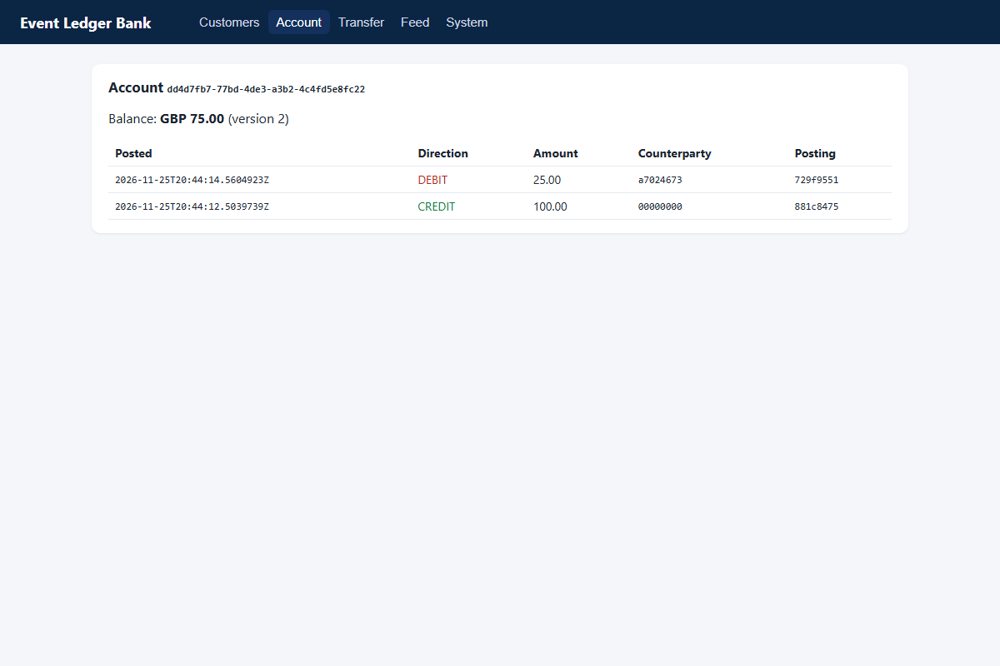
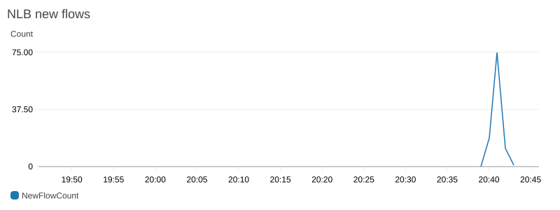

# Event Ledger Bank: a small banking backend on Go, Cassandra, Kafka, Envoy and Kubernetes

## The problem

Show what a modern bank backend looks like at small scale, with real infrastructure instead of mocks. Every money movement must be:

- a **double-entry posting** that always balances,
- **idempotent**, so a retried request never double-spends,
- **published as an event**, so other systems (a live feed, analytics) react without the ledger knowing about them.

The whole system runs locally on Docker/kind and in AWS on EKS, from the same code and images. Only configuration changes between the two.

## Architecture



- **Envoy** is the only way in and the only way between services. Timeouts, retries (`unavailable,reset,connect-failure`) and outlier detection live in its config, not in Go code. It also transcodes the browser's REST/JSON calls into gRPC.
- **ledger** moves balances with a Cassandra lightweight transaction (`UPDATE ... IF version = ?`), writes both entries with one `posting_id`, and publishes a protobuf event per entry.
- **transfers** claims the idempotency key with `INSERT ... IF NOT EXISTS`, so a replay returns the original transfer and never reaches the ledger.
- **Kafka** topics `ledger.posted`, `transfer.completed` and `transfer.failed` are keyed by account ID. Consumers commit offsets only after processing.
- **Observability:** OpenTelemetry traces (Jaeger locally), Prometheus metrics, JSON logs (`slog`) and Envoy JSON access logs.

## Stack → requirement

| Requirement | Where it shows up | Proof |
|---|---|---|
| Go backend, distributed systems, resilience | 5 services + `topic-init`; idempotency; Envoy retries and outlier detection; at-least-once consumers | [unit](../proof/phase1-local/tests/go-unit.log), [integration](../proof/phase1-local/tests/go-integration.log), [drill](../proof/phase1-local/logs/drill-ledger-restart.log) |
| gRPC + Protobuf + buf | `proto/bank/v1`, `buf lint/breaking/generate` | [buf-lint](../proof/phase1-local/tests/buf-lint.log) |
| Envoy for RPC | Front proxy, gRPC routing, JSON transcoding, SSE | [clusters](../proof/phase1-local/logs/envoy-clusters.txt), [system page](../proof/phase1-local/screenshots/05-system-health.png) |
| Cassandra → Keyspaces | Query-first tables, LWT; Keyspaces path is config-only (SigV4, TLS) | [cqlsh](../proof/phase1-local/logs/cqlsh-ledger.txt), [data model](data-model.md) |
| Kafka → MSK Serverless | franz-go producer/consumers, IAM SASL | [consumer log](../proof/phase1-local/logs/kafka-consume.txt), [MSK describe](../proof/phase2-cloud/logs/msk-describe.json) |
| Docker + Kubernetes (kind, EKS) | Kustomize base + `kind`, `eks` overlays | [kind](../proof/phase1-local/logs/kind-get-all.txt), [EKS](../proof/phase2-cloud/logs/kubectl-eks.txt) |
| React internal tools | Customers, account entries, transfer, live feed, system | screenshots below |
| Data / analytics | Kafka → sink → NDJSON → DuckDB locally, S3 + Glue + Athena in AWS | [DuckDB](../proof/phase1-local/logs/duckdb-daily-volume.txt), [Athena](../proof/phase2-cloud/logs/athena-daily-volume.txt) |
| Terraform, CI | `infra/` (VPC, EKS spot, ECR, MSK, S3, Glue, Athena, Pod Identity); GitHub Actions runs every cloud-free test | [resources](../proof/phase2-cloud/resources.txt) |

## Screenshots

Local (Docker Compose / kind):








AWS (EKS behind an NLB, MSK Serverless, S3 + Athena):






The full proof index is [proof/README.md](../proof/README.md), and the post-destroy check is [verify-destroyed.txt](../proof/phase3-destroy/verify-destroyed.txt).

## What was hard

- **Envoy gRPC-JSON transcoding.** The transcoder rewrites `/v1/...` into `/bank.v1.X/Method` and re-selects the route, so routes must match the rewritten gRPC paths, not the REST ones.
- **Retries that actually happen.** With a ClusterIP Service Envoy sees a single address, so killing a pod produced zero retries. Making the gRPC Services headless lets Envoy see pod IPs, and the force-delete drill then shows retries > 0 with 100% success.
- **Money without multi-row transactions.** The debit and credit are separate LWTs. The ledger records an idempotent posting marker, retries credits, and reverses the debit if the credit cannot land. A crash between the two steps still needs a recovery job (documented in [data-model.md](data-model.md)).
- **Amazon Keyspaces was not available to the deployer.** The deploying IAM user was denied `cassandra:*` even with PowerUserAccess. I did not grant myself more permissions, so the AWS run used the same services against Cassandra 5 inside EKS (Terraform keeps the Keyspaces resources behind `enable_keyspaces`, and the Keyspaces connection code is config-only). See [DECISIONS.md](DECISIONS.md).
- **A new AWS account blocks load balancers for a while.** The NLB failed with `OperationNotPermitted` for roughly 15 minutes before AWS allowed it. The deploy script now waits for it.
- **Plain HTTP broke the web app.** `crypto.randomUUID()` only exists in secure contexts, so deposits failed on the NLB's HTTP URL until a fallback was added. Only the AWS run caught this.
- **Windows tooling.** Git Bash rewrites `/opt/...` paths passed to Docker, and native Terraform/kubectl need `C:/` paths. Both are handled in `scripts/lib.sh` and `scripts/aws-env.sh`.

## Approximate AWS cost

About **USD 2** for roughly one hour of the stack being up: EKS control plane (USD 0.10/h), two spot `t3.medium` nodes, one NLB, MSK Serverless (about USD 0.75/h for the cluster plus partitions), a few public IPv4 addresses, and cents for S3, Athena, Glue and ECR. No NAT gateways. Everything was destroyed right after the proof was captured.

## Reproduce

```bash
scripts/dev-up.sh && scripts/test-all.sh        # local, no AWS
scripts/capture-proof.sh phase1                 # screenshots and logs from the compose stack
scripts/kind-up.sh && scripts/capture-proof.sh phase1-kind
scripts/deploy.sh                               # AWS (profile event-ledger-bank-deployer, ap-southeast-2)
scripts/destroy.sh && VERIFY_OUT=proof/phase3-destroy/verify-destroyed.txt scripts/verify-destroyed.sh
```
